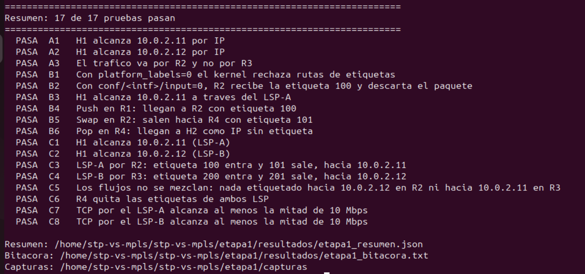
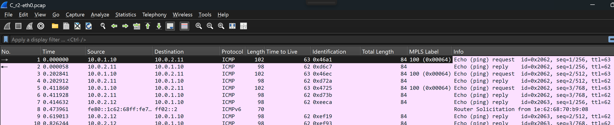
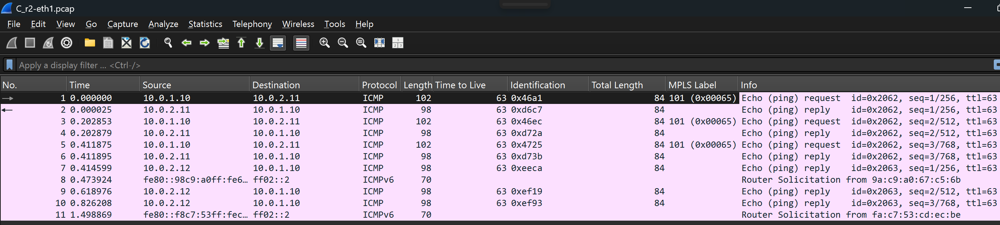
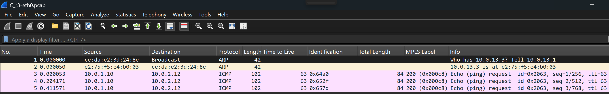
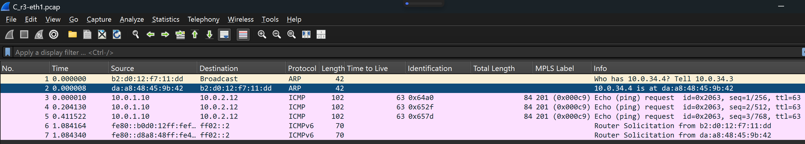

# Evidencias de la etapa 1 — capturas de Wireshark

Capturas de pantalla de los `.pcap` en `../capturas/`, tomadas después de correr `validar_mpls.py`.
En todas, la columna **MPLS Label** se agregó con clic derecho sobre `Label` → *Apply as Column*.

## Resultado del script

## LSP-A (H1 → 10.0.2.11, camino R1 → R2 → R4)

Mismo ping (`id=0x2062`, `seq=1, 2, 3`) visto a la entrada y a la salida de R2.

| Captura | Interfaz | Etiqueta | Qué demuestra |
|---|---|---|---|
| `C_r2-eth0.pcap` | entrada de R2 (desde R1) | **100** | Push en R1 |
| `C_r2-eth1.pcap` | salida de R2 (hacia R4) | **101** | Swap 100 → 101 en R2 |

## LSP-B (H1 → 10.0.2.12, camino R1 → R3 → R4)

Mismo ping (`id=0x2063`, `seq=1, 2, 3`) visto a la entrada y a la salida de R3.

| Captura | Interfaz | Etiqueta | Qué demuestra |
|---|---|---|---|
| `C_r3-eth0.pcap` | entrada de R3 (desde R1) | **200** | Push en R1 |
| `C_r3-eth1.pcap` | salida de R3 (hacia R4) | **201** | Swap 200 → 201 en R3 |

## Observaciones para el informe

- **Los 4 bytes de la etiqueta.** Los requests etiquetados miden 102 bytes y las respuestas 98. La diferencia es la cabecera MPLS (una etiqueta = 4 bytes).
- **Las respuestas no llevan etiqueta.** Los *echo reply* vuelven por IP normal y siempre por R2 (decisión 2 del README). Por eso aparecen respuestas de `.12` en las capturas de R2, y en R3 solo hay requests, que Wireshark marca como *no response found*.
- **Los flujos no se mezclan.** En R2 solo hay etiquetas 100/101 (hacia `.11`) y en R3 solo 200/201 (hacia `.12`).
